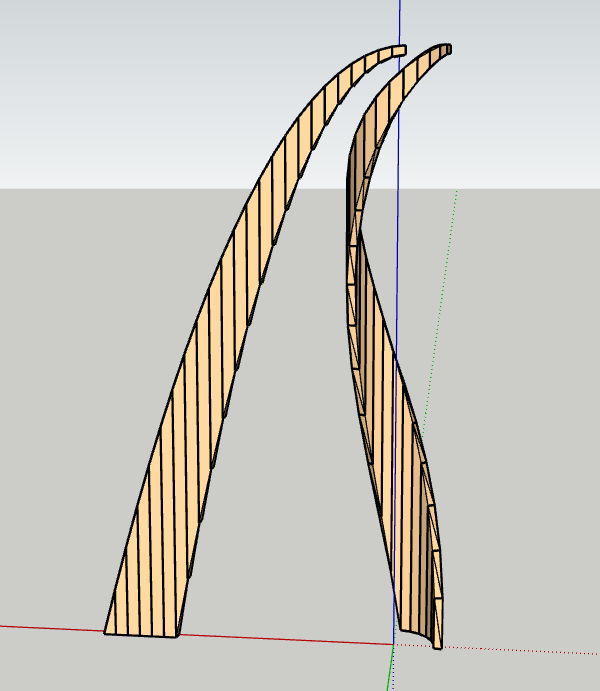
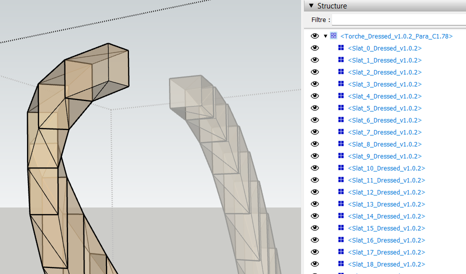
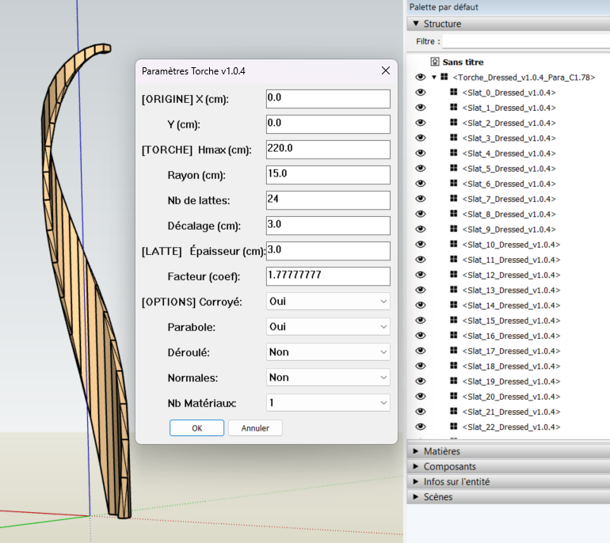

## Aperçu du résultat
Voici un exemple de volume généré en mode "corroyé" avec une courbe parabolique (paramètre par défaut):

  

# 🪵 Générateur de Torche en bois pour SketchUp 

Plugin Ruby pour SketchUp permettant de générer des modèles de "Torche en bois" avec une gestion avancée des courbes, du placement et des matériaux.

  

## 🛠 Installation

### Méthode Automatique (Fichier .rbz)
1. Aller dans la section **Releases** de ce dépôt.
2. Télécharger le fichier `.rbz` le plus récent.
3. Dans SketchUp : `Fenêtre` $\rightarrow$ `Gestionnaire d'extensions` $\rightarrow$ `Installer l'extension`.
4. Sélectionner le fichier `.rbz`.

## 📖 Guide d'utilisation

Le plugin est accessible via le menu : `Extensions` $\rightarrow$ `Olliwa Torche generator v[VERSION]`.

## 🚀 Fonctionnalités

- **Modes de Génération** : Choix entre **Corroyé** et **Non corroyé**.
- **Géométrie Flexible** : 
  - Courbes **Paraboliques** (les bords de la torche suivent deux paraboles ajustables via un ratio de valeur 16/9 par défaut).
  - Courbes **Linéaires** (les bords suivent deux droites).
- **Mise en page "Déroulée"** : Option pour placer les lattes côte à côte linéairement (à plat) au lieu d'être distribuées circulairement.
- **Personnalisation** :
  - rayon du cylindre, nombre de lattes, décalage entre les deux courbes et épaisseur des lattes.
  - hauteur maximale de la torche et du positionnement du centre de la base de la torche (X,Y).
- **Gestion Intelligente des Matériaux** :
  - monochrome ou bicolore.
  - **Cycle Alterné** : En mode 2 matériaux, le plugin applique automatiquement un cycle de **2 lattes en Bois Clair pour 1 latte en Bois Foncé**.
- **UI Persistante** : L'interface mémorise les derniers réglages durant la session pour optimiser les tests.

  

## 📋 Prérequis
- **SketchUp 2020** ou version ultérieure.
- **Ruby** (intégré à SketchUp).

## 📄 Licence
Ce projet est distribué sous la licence MIT. Voir le fichier `LICENSE` pour plus de détails.