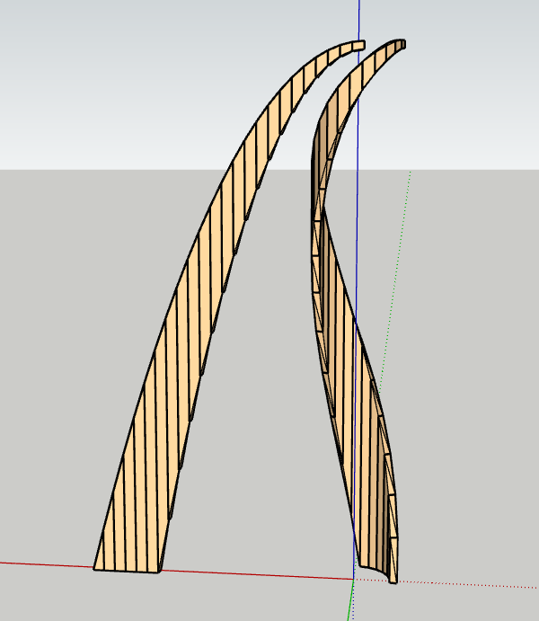
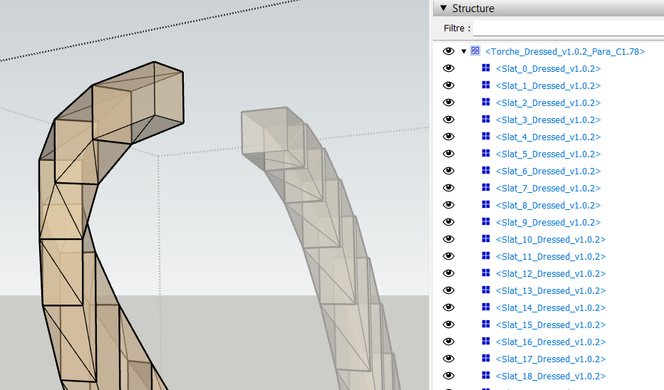

## Aperçu du résultat
Voici un exemple de volume généré en mode "Dressed" avec une courbe parabolique (parametre par défaut):

<p align="center">
  
</p>


<p align="center">
  
</p>

# 🪵 Générateur de Torche en bois pour SketchUp 2020+

Un plugin Ruby pour SketchUp permettant de générer des volumes de "Torche" avec une gestion avancée des courbes, du placement et des matériaux.

## 🚀 Fonctionnalités

- **Modes de Génération** : Choix entre **Dressed (Corroyé)** et **OpenCutList (OCL)**.
- **Géométrie Flexible** : 
  - Courbes **Paraboliques** (les bords de la torche suivent deux paraboles ajustables via un ratio).
  - Courbes **Linéaires** (les bords suivent deux droites).
- **Mise en page "Déroulée"** : Option pour placer les douelles côte à côte linéairement (à plat) au lieu d'une distribution circulaire.
- **Personnalisation Précise** :
  - Ajustement du rayon, nombre de quartiers, décalage et épaisseur.
  - Contrôle de la hauteur maximale (`Hmax`) et du positionnement (X,Y).
- **Gestion Intelligente des Matériaux** :
  - Support monochrome ou bicolore.
  - **Cycle Alterné** : En mode 2 matériaux, le plugin applique automatiquement un cycle de **2 lattes en Bois Clair pour 1 latte en Bois Foncé**.
- **UI Persistante** : L'interface mémorise vos derniers réglages durant la session pour optimiser vos tests.

## 🛠 Installation

### Méthode Automatique (Recommandée)
1. Allez dans la section **Releases** de ce dépôt.
2. Téléchargez le fichier `.rbz` le plus récent.
3. Dans SketchUp : `Fenêtre` $\rightarrow$ `Gestionnaire d'extensions` $\rightarrow$ `Installer l'extension`.
4. Sélectionnez le fichier `.rbz`.

### Méthode Manuelle
1. Téléchargez le dossier `torche_dyn`.
2. Copiez-le dans le répertoire des plugins de SketchUp :
   - **Windows** : `%AppData%\SketchUp\SketchUp 2020\SketchUp\Plugins`
   - **macOS** : `~/Library/Application Support/SketchUp 2020/SketchUp/Plugins`
3. Assurez-vous que le fichier `torche_dyn_loader.rb` est présent à la racine du dossier `Plugins`.
4. Redémarrez SketchUp.

## 📖 Guide d'utilisation

Le plugin est accessible via le menu : `Extensions` $\rightarrow$ `Générer Torche v[VERSION]`.

### Paramètres de l'interface
| Paramètre | Description |
| :--- | :--- |
| **Mode** | Choisir entre `Dressed` (Corroyé) ou `OCL` (liste de coupe). |
| **Courbe** | `Para` pour un arc parabolique, `Lin` pour des arcs droits. |
| **Déroulé** | Si `Vrai`, les douelles sont alignées linéairement. Si `Faux`, elles forment un cylindre. |
| **Coeff** | Modifie la courbure et la hauteur finale des lattes en mode Parabolique. |
| **Nb Matériaux** | `1` pour une couleur unique, `2` pour activer l'alternance Bois Clair/Foncé. |

## 🏗 Architecture Technique

Le code est modularisé pour garantir la stabilité et faciliter la maintenance :

- **`main.rb`** : Point d'entrée, chargement des modules et création du menu.
- **`config.rb`** : Centralisation des constantes, couleurs RGB et valeurs par défaut.
- **`ui_handler.rb`** : Gestion des entrées utilisateur et persistance des données (`@@last_params`).
- **`core.rb`** : Moteur géométrique, calculs mathématiques et placement des instances.
- **`logger.rb`** : Système de logs robuste avec fichiers de session datés.

## 📝 Informations techniques
- **Version** : 1.0.0
- **Compatibilité** : SketchUp 2020+
- **Langage** : Ruby
- **Licence** : [Indiquez votre licence, ex: MIT]

## 🛠 Développement & Build

### Compilation du Plugin
Le projet inclut un script de build pour générer le package distribuable :
```bash
chmod +x build_release.sh
./build_release.sh
```
Ce script extrait la version depuis `config.rb` et package le plugin au format `.rbz`.

