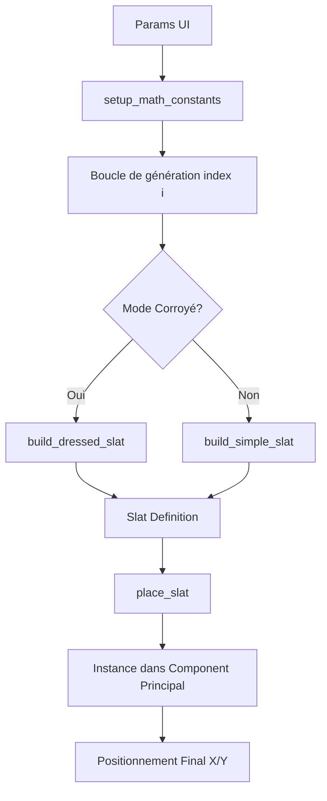

# ⚙️ Documentation Technique : Core Engine (`core.rb`)

Le module `Core` est le cœur géométrique du plugin. Il est responsable de la transformation des paramètres utilisateurs en une structure 3D complexe dans SketchUp.

## 🛠 Architecture de la Classe
La classe `Core` fonctionne selon un flux linéaire :
`initialize` $\rightarrow$ `generate` $\rightarrow$ `setup_math_constants` $\rightarrow$ `create_slat_definition` $\rightarrow$ `place_slat`.

---

## 📐 Logique Mathématique

### 1. Calcul des Constantes (`setup_math_constants`)
Le moteur calcule d'abord des valeurs partagées pour toutes les douelles afin d'optimiser les performances :
- **Largeurs** : Calcule les dimensions intérieure (`@interieur`) et extérieure (`@exterieur`) en utilisant la tangente de l'angle d'un quartier.
- **Coefficients de Courbure** : 
  - **Linéaire** : La hauteur décroît de façon proportionnelle à la distance $x$.
  - **Parabolique** : La hauteur suit une courbe quadratique ($x^2$), créant un effet d'arc plus organique.
- **Seuil Médian (`@mid_threshold`)** : Détermine le point de bascule où la douelle passe d'une hauteur maximale à une hauteur réduite (gestion du décalage).

### 2. Génération des Douelles (`create_slat_definition`)
Chaque douelle est créée comme une `ComponentDefinition` unique.
- **Calcul des Hauteurs** : Pour chaque index $i$, le moteur calcule quatre valeurs de hauteur ($y$) basées sur les coefficients choisis et la position $x$ actuelle et suivante.
- **Cycle de Matériaux** : Implémente l'algorithme de cycle `index % 3`.
  - `0` $\rightarrow$ Matériau 1 (Clair)
  - `1` $\rightarrow$ Matériau 1 (Clair)
  - `2` $\rightarrow$ Matériau 2 (Foncé)

---

## 🧊 Modes de Construction

### Mode OpenCutList (OCL) : `build_simple_slat`
C'est la méthode la plus simple :
1. Création d'un profil rectangulaire basé sur les points de base.
2. Application d'un `pushpull` pour créer le volume.
3. Idéal pour l'exportation vers des logiciels de découpe.

### Mode Dressed (Corroyé) : `build_dressed_slat`
C'est la méthode complexe qui génère un volume fermé et sculpté :
- **Géométrie** : Construit un volume à partir de **8 points** et **12 faces**.
- **Adaptabilité** : Si les points de base sont confondus (cas limites), le moteur bascule automatiquement en mode **triangulation** pour éviter les erreurs de création de faces SketchUp.
- **Post-traitement** : 
  - `orient_faces_outward` : Calcule le centroïde global pour s'assurer que toutes les normales des faces pointent vers l'extérieur (évite les faces "bleues/inversées").
  - `visualize_normals` : Optionnel, trace des lignes rouges pour le débogage.

---

## 📍 Placement et Distribution (`place_slat`)

Le moteur supporte deux modes de distribution spatiale :

| Mode | Logique de Placement | Transformation |
| :--- | :--- | :--- |
| **Déroulé** | Distribution linéaire sur l'axe X. | Translation simple. |
| **Circulaire** | Distribution sur un arc de cercle. | Translation + Rotation autour de l'axe Z. |

---

## 📝 Résumé des flux de données

## ⚠️ Gestion des Erreurs
Pour éviter que le plugin ne s'arrête brutalement en cas de géométrie impossible (ex: face trop petite), chaque étape de création de face est encapsulée dans des blocs `begin...rescue`. Les erreurs sont redirigées vers le `LogManager` sans interrompre la génération des autres douelles.