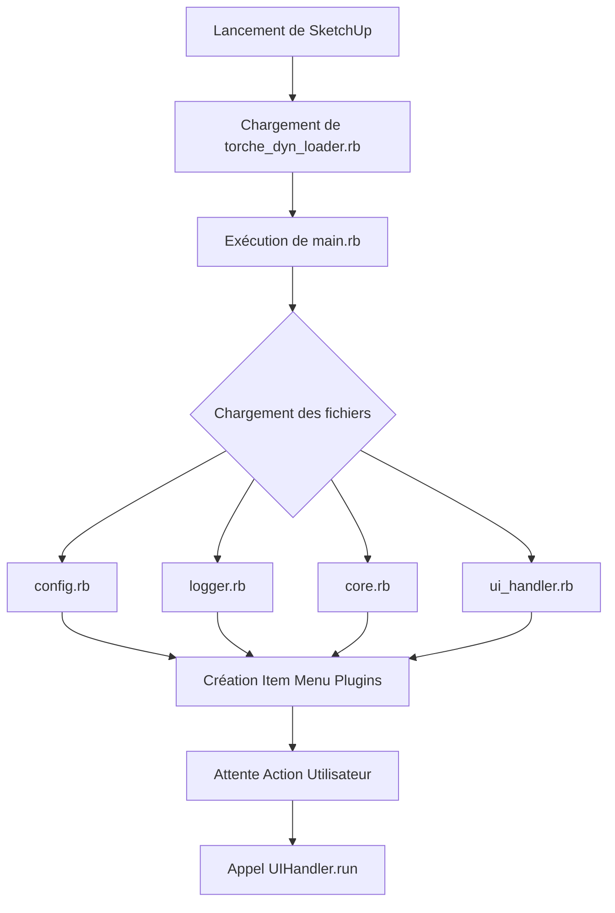

# Documentation du Point d'Entrée (`main.rb`)

Le fichier `main.rb` agit comme le chef d'orchestre du plugin. Son rôle principal est de charger les composants du module `TorcheDyn` dans le bon ordre et d'enregistrer la commande dans le menu de SketchUp.

## 🚀 Processus de Chargement

Le script utilise un mécanisme de chargement dynamique pour s'assurer que toutes les dépendances sont présentes avant l'exécution.

### 1. Localisation et Chemins
Le script commence par déterminer le chemin absolu du répertoire courant :
`current_dir = File.expand_path(File.dirname(__FILE__))`
Ceci garantit que le plugin peut être chargé quel que soit l'emplacement du dossier des plugins de l'utilisateur.

### 2. Séquence de chargement
Le fichier charge les scripts dans l'ordre suivant pour respecter les dépendances :
1. `config.rb` $\rightarrow$ (Contient les constantes et paramètres par défaut).
2. `logger.rb` $\rightarrow$ (Initialise le `LogManager` pour tracer le chargement).
3. `core.rb` $\rightarrow$ (Définit la logique de génération géométrique).
4. `ui_handler.rb` $\rightarrow$ (Définit l'interface utilisateur).

### 3. Sécurisation du chargement
Pour chaque fichier, le script effectue les vérifications suivantes :
- **Existence** : Vérifie si le fichier est présent sur le disque via `File.exist?`.
- **Intégrité** : Utilise un bloc `begin...rescue` pour capturer les erreurs de syntaxe ou d'exécution lors du `load`.
- **Traçabilité** : Affiche des indicateurs visuels dans la console Ruby de SketchUp (✅, ❌, ❓) pour faciliter le diagnostic rapide.

## 🖱️ Intégration SketchUp

Une fois les modules chargés, le script crée le point d'accès pour l'utilisateur final.

### Menu "Plugins"
Le plugin s'ajoute dynamiquement au menu **Plugins** de SketchUp. 

- **Nom de l'item** : `Générer Torche v[VERSION]`
- **Dynamisme** : Le numéro de version est récupéré directement depuis `TorcheDyn::Config::VERSION`. Si le module de configuration est manquant, il utilise une version par défaut (`0.0.0`).
- **Action** : Le clic sur cet item déclenche la méthode `TorcheDyn::UIHandler.run`, qui lance la boîte de dialogue de saisie.

### Prévention du double chargement
Le script utilise une condition `unless file_loaded?(__FILE__)`. Cela empêche la création de doublons dans le menu SketchUp si le script `main.rb` est rechargé manuellement durant la session.

## 📋 Résumé du Flux de Démarrage

